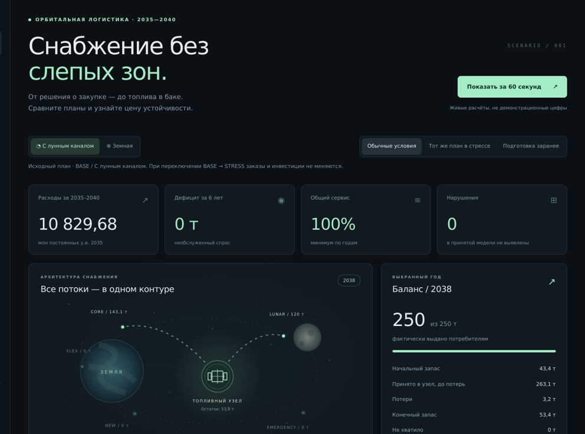
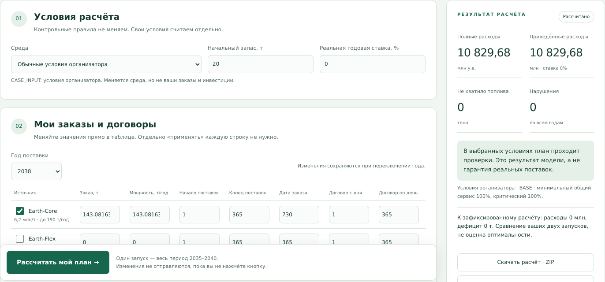
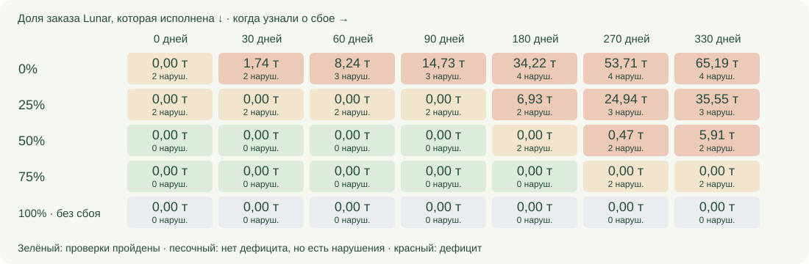

<p align="center">
  
</p>

<h1 align="center">🦥🛰 ЛЕНИВЫЕ В ОРБИТЕ</h1>

<p align="center"><b>КОСМОКОНТУР 2035</b> — топливная логистика орбитальной заправки<br>
<i>Модель → выбор → стресс → доказательства</i></p>

<p align="center">
  
  
  
  
  
</p>

---

## Кто это и зачем

Мы — команда **«Ленивые в орбите»** (Санкт-Петербург), участники **КосмоХакатон 2026**.
Этот репозиторий — наш комплект по хакатону: работающее решение основного кейса
и презентационные материалы по пожарному кейсу.

| Кейс | Что внутри | Куда смотреть |
|---|---|---|
| **«Топливный космоконтур 2035»** — основное решение | Калькулятор снабжения условной орбитальной заправки на 2035–2040: спрос, цены, поставки, договоры, запас, инвестиции; проверка запаса, сервиса и устойчивости к сбою | [solutions/fuel-contour](solutions/fuel-contour/README.md) |
| **«Мониторинг природных пожаров» (КосмоФАЙР-2)** | Презентационный комплект защиты: 12 слайдов, PDF/PPTX/автономный HTML, речь, сверка с официальными критериями | [presentations/cosmofire-2026](presentations/cosmofire-2026/README.md) |

Учебный сценарный планировщик, а не система управления реальным оборудованием.
Данные организаторов используются в рамках соревнования; ключи и секреты в репозиторий не входят.

## Быстрый старт

```bash
git clone https://github.com/overbaffe1/CosmoH.git
cd CosmoH/solutions/fuel-contour
bash tools/setup.sh
.venv/bin/python -m uvicorn fuel.api:app --host 0.0.0.0 --port 8000
```

Открыть <http://localhost:8000> — это калькулятор (`/`), `/planner` — расширенный редактор,
`/demo` — контрольные примеры, `/evidence` — доказательства, `/presentation` — защита.

Тесты: `.venv/bin/python -m pytest -q` → **137 passed**.

## Как это выглядит

<p align="center">
  
</p>
<p align="center"><i>Стартовый экран: «Космическая заправка. Земные решения.»</i></p>

<p align="center">
  
</p>
<p align="center"><i>Калькулятор: свои условия → «Рассчитать мой план» → расходы, баланс, нарушения.</i></p>

<p align="center">
  
</p>
<p align="center"><i>Не один удачный пример: границы решения — 35 сочетаний тяжести сбоя и задержки реакции.</i></p>

## Что внутри

```text
.
├── solutions/fuel-contour/        # Космоконтур 2035: ядро evaluate(), FastAPI, CLI, web, 137 тестов
│   ├── fuel/                      #   расчётное ядро и API
│   ├── configs/                   #   четыре TEAM_DECISION (earth/lunar × base/stress)
│   ├── tests/ · tools/            #   проверки, воспроизведение, пакет для GitVerse
│   └── docs/                      #   записка, презентация, jury-навигатор, evidence
├── presentations/cosmofire-2026/  # КосмоФАЙР-2: сборка слайдов (build_deck.py), PDF/PPTX/HTML, sources/
├── docs/team/                     # маскот, аватар, командные картинки, hero-баннер
└── regulation.pdf · policy.pdf · consent.pdf   # исходные организационные документы
```

## Материалы проекта

| Материал | Где открыть |
|---|---|
| Решение, возможности и ограничения | [README решения](solutions/fuel-contour/README.md) |
| Запуск, воспроизведение, тесты | [RUNBOOK](solutions/fuel-contour/RUNBOOK.md) |
| Управленческая записка · 10 страниц | [PDF](solutions/fuel-contour/docs/REPORT.pdf) |
| Сравнение архитектур · 1 страница | [PDF](solutions/fuel-contour/docs/COMPARISON.pdf) |
| Презентация · 10 слайдов, 4 минуты | [PDF](solutions/fuel-contour/docs/PRESENTATION.pdf) · [PPTX](solutions/fuel-contour/docs/PRESENTATION.pptx) |
| Все 20 критериев и подтверждения | [Навигатор жюри](solutions/fuel-contour/docs/JURY_GUIDE.md) |
| Передача на GitVerse, безопасные команды | [GITVERSE.md](solutions/fuel-contour/GITVERSE.md) |
| Пожарный кейс: комплект защиты | [КосмоФАЙР-2](presentations/cosmofire-2026/README.md) |
| Команда, маскот, название | [docs/team](docs/team/README.md) |

GitVerse команды: <https://gitverse.ru/hackrus.experts/kosmo-piter_lenivye_v_orbite_197>.
Публикация туда — отдельный шаг владельца; ссылка сама по себе не означает сдачу.

## Команда


**«Ленивые в орбите»**, Санкт-Петербург. Девиз: **«Спешить не будем. Но успеем.»**
Каноническая подача — ленивец в скафандре: неспешный, но всё успевает — как наш
подход к расчётам. Маскот создан с помощью ИИ; это оформление команды, не научные данные.

Участники **КосмоХакатон 2026**: работа над кейсом «Топливный космоконтур 2035»
и подготовка защиты по кейсу «Мониторинг природных пожаров».

## Статус без приукрашивания

- Собственные проверки (137 тестов) отделены от неизменённого валидатора организатора:
оригинальный reference validator останавливается на ссылке на отсутствующий `docs/ERRATA_AND_PROVENANCE.md`. Общий gate не объявляется зелёным.
- GitHub — публикация и портфолио, не подтверждение сдачи на GitVerse.
- Черновые данные хакатона (≈3,3 ГБ RAR-архивов: постановки, транскрипции, датасеты) из дерева
  удалены; эталонный состав файлов соответствует ветке `arena/01a0b7c5-cosmoh`.
- **Git-история не переписана:** удалённые блобы остаются в старых коммитах (pack ≈ 3,3 ГиБ).
  Для портфолио достаточно текущего дерева; для GitVerse используйте автономный ZIP из
  `tools/package.py`. Полная чистка истории — отдельная операция (`git filter-repo` +
  force push), она сюда намеренно не включена.

---

<p align="center"><sub>© 2026 · Команда «Ленивые в орбите» · КосмоХакатон 2026 · Санкт-Петербург</sub></p>
