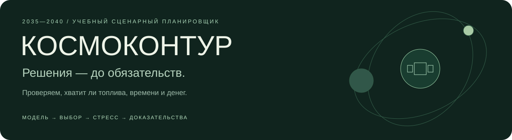

# #🦥🛰ЛЕНИВЫЕ В ОРБИТЕ
## Топливный космоконтур 2035

[](solutions/fuel-contour/README.md)

**Наш кейс — снабжение космической заправки, 2035–2040.**
Калькулятор позволяет задавать спрос, цены, поставки, договоры, запас и инвестиции,
пересчитывать расходы и баланс, находить нарушения и сохранять собственные проекты.
Это учебный планировщик, не система управления реальным оборудованием.

### Запустить сайт

Python 3.11+, команды из корня этого репозитория:

```bash
cd solutions/fuel-contour
bash tools/setup.sh
.venv/bin/python -m uvicorn fuel.api:app --host 0.0.0.0 --port 8000
```

На своём компьютере: <http://localhost:8000>. В Arena — Live Preview порта 8000.
Главная `/` — калькулятор; `/planner` — расширенный редактор; `/demo` — контрольные
примеры; `/evidence` — доказательства; `/presentation` — презентация.

### Всё для защиты и сдачи

| Материал | Где открыть |
|---|---|
| Решение, возможности и ограничения | [README решения](solutions/fuel-contour/README.md) |
| Передача на GitVerse, безопасные команды | **[GITVERSE.md](solutions/fuel-contour/GITVERSE.md)** |
| Управленческая записка · 10 страниц | [PDF](solutions/fuel-contour/docs/REPORT.pdf) |
| Сравнение архитектур · 1 страница | [PDF](solutions/fuel-contour/docs/COMPARISON.pdf) |
| Презентация · 10 слайдов, 4 минуты | [PDF](solutions/fuel-contour/docs/PRESENTATION.pdf) · [PPTX](solutions/fuel-contour/docs/PRESENTATION.pptx) |
| Речь и ответы на вопросы | [TXT](solutions/fuel-contour/docs/TALK_4_MIN.txt) |
| Все 20 критериев и подтверждения | [Навигатор](solutions/fuel-contour/docs/JURY_GUIDE.md) |
| Установка, воспроизведение, тесты | [RUNBOOK](solutions/fuel-contour/RUNBOOK.md) |
| Название и маскот команды | [Команда](docs/team/README.md) |

GitVerse команды: <https://gitverse.ru/hackrus.experts/kosmo-piter_lenivye_v_orbite_197>.
Публикация туда — отдельный шаг владельца; ссылка сама по себе не означает сдачу.

### Что осталось в репозитории

- `solutions/fuel-contour/` — только наш проект: код, конфигурации, тесты, исходные материалы,
  отчёты, презентация, речь и инструменты упаковки.
- `docs/team/` — оформление команды.
- `regulation.pdf`, `policy.pdf`, `consent.pdf` — исходные организационные документы.
- `.github/workflows/fuel-contour.yml` — независимые проверки решения и внешнего валидатора.

Материалы других решений удалены из текущей ветки. Старая Git-история не переписана;
**для GitVerse используйте автономный ZIP**, а не перенос всей истории CosmoH.
В ZIP README, код и команды находятся сразу в корне, без `solutions/fuel-contour/`.

### Статус без приукрашивания

Собственные проверки отделены от неизменённого валидатора организатора. Последний
останавливается на ссылке на отсутствующий `docs/ERRATA_AND_PROVENANCE.md`.
Общий gate не объявляется зелёным. Исходные 37 файлов test_oil и 3 PDF orbit сохранены.
Токены, ключи и пароли в комплект не входят.
