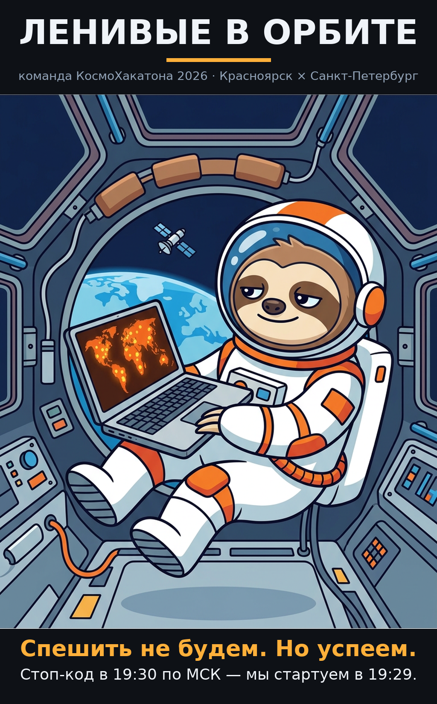

# Команда «ЛЕНИВЫЕ В ОРБИТЕ» — название, описание, картинки

Дата: 18.09.2026 · КосмоХакатон 2026 · Красноярск (онлайн) × Санкт-Петербург (онлайн)



Аватар для платформы и Telegram: `team_avatar.png` (512×512)

---

## Выбранное название

### **ЛЕНИВЫЕ В ОРБИТЕ**

Короткая версия для чата и платформы: **Ленивые**

Девиз: **«Спешить не будем. Но успеем.»**
Вторая строка: **«Стоп-код в 19:30 по МСК — мы стартуем в 19:29.»**

Почему это работает:

* **Мемный контраст.** Космос = скорость, ленивец = «сделаем в последний момент» — и это ровно
  про реальность хакатона: 90 % работы делается в последние часы перед стоп-кодом.
* **Актуально для Красноярска.** Все в чате обсуждают часовой пояс: «а по МСК?», «а по местному?»,
  «награждение в 23:00 это сильно». Шутка про **19:30 по МСК** — это ровно тот мем, который сейчас
  в чате, и он показывает, что мы разобрались в расписании.
* **Соответствует правилам.** П. 10.4 Положения: название не должно содержать нецензурных,
  оскорбительных или дискриминационных формулировок — «Ленивые в орбите» чистое.
* **Самопозиционирование.** На защите легко отыграть: «Название — с иронией, а метрики — без.
  Ленивые, но F1 0.94 и ошибка площади 0.6 %».

## Описание команды (для профиля на платформе)

> **ЛЕНИВЫЕ В ОРБИТЕ** — команда двух окружных КосмоХакатонов: Красноярск (оперативный мониторинг
> лесных пожаров) и Санкт-Петербург (орбитальный риск для ВКД).
>
> Иронизируем над собой, но не над результатом: за хакатон у нас работающий прототип, открытые
> данные (NASA FIRMS, Sentinel-2, NOAA SWPC) и метрики, которые можно проверить, а не «скриншот
> красивой картинки».
>
> Девиз команды отражает суть хакатона: спешить не будем — но успеем. До стоп-кода, всегда до стоп-кода.

## Короткий текст для чата (объявление о поиске людей)

> Всем привет! Мы **ЛЕНИВЫЕ В ОРБИТЕ** 🦥🛰 — спешить не будем, но успеем.
> Собираем состав 3–5 человек: Красноярск (пожары по MODIS/VIIRS/Sentinel-2) и СПб (риск ВКД по
> космической погоде). У нас уже есть работающий прототип, метрики и презентация — ищем тех, кто
> усилит данные/модель или фронт. Пишите в личку: 5 минут на созвон и распределяем задачи.

## Слоган-варианты (если нужно покороче для аватара)

| Вариант | Где уместен |
|---|---|
| Спешить не будем. Но успеем. | общий девиз |
| F1 0.94 без спешки | под кейс пожаров |
| Дозу посчитаем, паниковать не будем | под кейс ВКД |
| Сон — тоже часть спринта | для ночного чата, когда все устали |
| Работаем в темпе 19:29 | для мемов про стоп-код |

## Как пересобрать картинки

```bash
python3 docs/team/make_team_art.py     # обновит team_meme.png и team_avatar.png
```

Скрипт убирает белые поля, автоматически подбирает кегль под ширину (кириллица не обрезается)
и делает круглый аватар из исходного маскота `mascot_raw.png`.

## Что сгенерировано и как это подать

* Иллюстрация — сгенерирована ИИ по нашему заданию (промпт в `make_team_art.py`/истории).
  Это маскот команды, а не элемент конкурсного решения, поэтому правила п. 9.5/9.6 (раскрытие
  источников и своего вклада) на неё не влияют; при желании можно упомянуть в README.
* П. 10.5 (нельзя публиковать решение без согласования) на маскот и название не распространяется —
  они не являются частью решения проекта.
