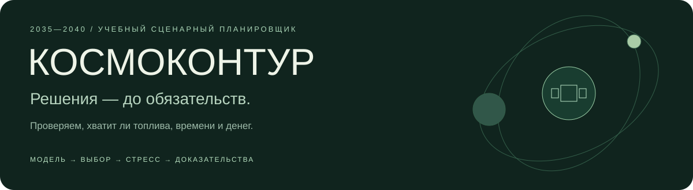
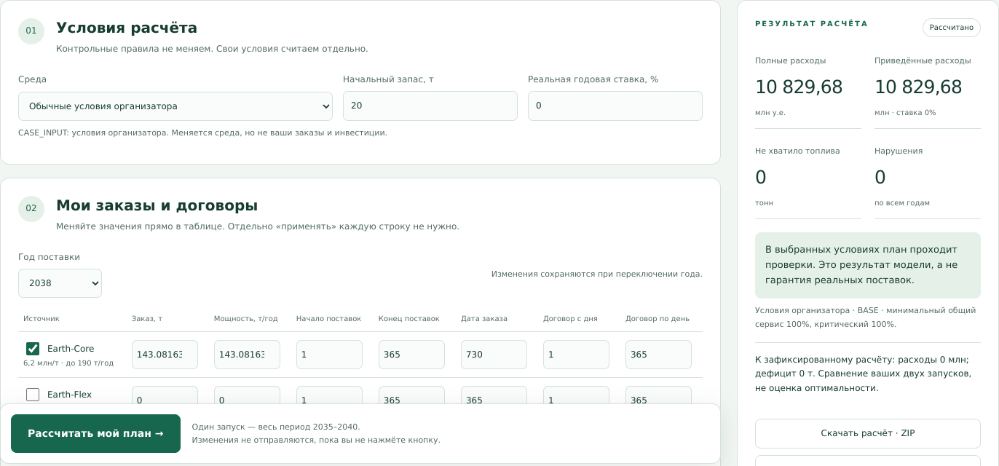
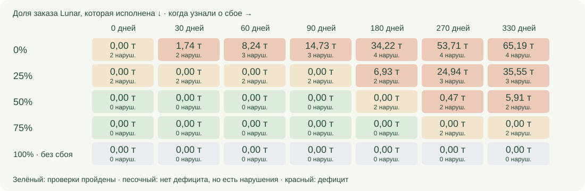

# Топливный космоконтур 2035

**Команда #🦥🛰ЛЕНИВЫЕ В ОРБИТЕ · Санкт-Петербург**

[GitVerse команды](https://gitverse.ru/hackrus.experts/kosmo-piter_lenivye_v_orbite_197) · **[Команды для публикации](GITVERSE.md)**




<p align="center">
<a href="docs/PRESENTATION.pdf"><b>10 слайдов</b></a> ·
<a href="docs/JURY_GUIDE.md"><b>20 критериев</b></a> ·
<a href="docs/DEMO_EVIDENCE.md"><b>Примеры и замеры</b></a> ·
<a href="RUNBOOK.md"><b>Запустить</b></a>
</p>

**Космическая заправка, земная логика.** Выбираем, откуда и когда привезти топливо,
сколько держать в запасе и во что вложиться. Проверяем цену решения **и то, переживёт ли оно сбой**.

## Откройте нужный маршрут

| Кто вы | С чего начать | Что получите |
|---|---|---|
| Хочу быстро понять | [Объяснение и речь на две минуты](docs/DEFENSE_GUIDE.md) | Суть без аббревиатур |
| Готовлю защиту | [Презентация](docs/PRESENTATION.pdf) · [PPTX](docs/PRESENTATION.pptx) · [речь TXT](docs/TALK_4_MIN.txt) | 4 минуты + 2 минуты вопросов; стек и настоящая лаборатория |
| Проверяю решение | [Навигатор по 20 критериям](docs/JURY_GUIDE.md) | Доказательство и ограничение по каждому пункту |
| Хочу повторить | [RUNBOOK](RUNBOOK.md) · [протокол](docs/VERIFICATION.md) | Установка, расчёт, тесты, ожидаемый статус |

> **Статус без приукрашивания:** собственные проверки и внешний gate разделены.
> Оригинальный reference validator останавливается на отсутствующей upstream-ссылке.
> Это не скрыто и не исправлено подставным файлом. GitHub — публикация, не подтверждение сдачи на GitVerse.

<details>
<summary><b>Посмотреть работающий интерфейс</b></summary>



Свои условия → «Рассчитать мой план» → расходы, баланс и нарушения.
Контрольные примеры вынесены в `/demo`; их снимки и замеры — [галерея](docs/DEMO_EVIDENCE.md).
При запуске приложения: `/` — работа с планом, `/evidence` — снимки и измерения, `/presentation` — защита.
</details>

## Не один удачный пример — границы решения



**Ноль дефицита не всегда означает выполнимость.** При исполнении 50% лунного заказа
реакция через 90 дней проходит проверки; через 180 дней дефицита также нет, но остаются
два нарушения резерва. 100% исполнения — контроль без сбоя, не успешное «спасение».

[Сетка CSV](docs/evidence/response-grid.csv) · [Полные последствия](docs/evidence/response-grid.json) ·
[Один день баланса вручную](docs/evidence/BALANCE.md) · [Методика замера UI](docs/DEMO_EVIDENCE.md)

---

## Наглядный сайт и режим защиты

Сначала прочитайте [объяснение кейса и план выступления](docs/DEFENSE_GUIDE.md). Это задача оператора условной космической заправки: обеспечить миссии вовремя и объяснить цену защиты от сбоев.

После запуска сервера:
- `/` — **калькулятор**: свой спрос по годам, цены и исполнение поставок, начальный запас, ставка, заказы/резервы, даты договоров и инвестиции. Одна кнопка «Рассчитать мой план» запускает общее ядро.
- `/demo` — отдельные контрольные примеры, схема снабжения, 2×2 и ограниченная реакция на сбой.
- `/planner` — расширенный редактор данных и исследовательских проектов, прежние возможности сохранены.
- `/evidence` (также `/evidence/`) — доказательства; ссылка открывается в той же вкладке.
- `/presentation` — 10 слайдов, стрелки / Home / End, выбор слайда, полный экран. **Подсказок докладчику нет**; речь — отдельный [TXT](docs/TALK_4_MIN.txt).
- `/api/recourse` — опыт после наблюдения недопоставки Lunar: новый Emergency-контракт, старые решения не меняются.

Светлая тема по умолчанию, переключатель в шапке. Результат после изменения входов помечается
устаревшим: выгрузка недоступна до нового расчёта. Можно закрепить результат и сравнить следующий
запуск, сохранить/открыть собственный JSON и скачать ZIP с CSV/XLSX.

Официальные BASE/STRESS не наследуют пользовательские множители и спрос. Свои условия —
отдельный `TEAM_ASSUMPTION`, без изменения источников организатора. Калькулятор сохраняет
`fuel-calculator-v1`; расширенные проекты и исследовательские входы открываются в `/planner`.
Параметры `architecture/mode/year` в URL и кешированные примеры относятся **только к `/demo`**,
не заменяют сохранение проекта. Опубликованные времена `/demo` не являются замером нового калькулятора.

Аварийный контракт и дополнительное финансирование — объявленное TEAM-допущение,
не гарантия. Протокол — [RECOURSE.md](docs/RECOURSE.md).


## Если нужно понять кейс и подготовить защиту

- [Объяснение по-человечески и чек-лист выступления](docs/DEFENSE_GUIDE.md).
- [Внутренняя прикидка по всем 20 критериям](docs/SCORECARD.md) — не баллы жюри.
- [10 слайдов PDF](docs/PRESENTATION.pdf), [редактируемый PPTX](docs/PRESENTATION.pptx), [слова к слайдам](docs/SPEAKER_NOTES.md).
- [Связь научных методов с конкретными функциями/тестами](docs/METHODS_TRACE.md).
- Новый `results/decision_brief.json`: сначала выполнимость, затем приведённая стоимость;
  для контрольных BASE-планов выбор по ставке меняется около 8,92%. Это не ставка рынка.


Работающий web/CLI-планировщик снабжения орбитального топливного узла на 2035–2040 годы.
Python 3.11, FastAPI, собственный HTML/JS без CDN. Нет закрытых API, платных подписок,
телеметрии или генерации чисел нейросетью вместо расчёта.

**Опубликованная ветка:** https://github.com/overbaffe1/CosmoH/tree/arena/01a0b7c5-cosmoh/solutions/fuel-contour

Три PDF из `overbaffe1/orbit` прочитаны, сверены и сохранены с SHA256 в `references/orbit`.
Карта требований и изменений: [docs/PDF_AUDIT.md](docs/PDF_AUDIT.md).
Собственные проверки отделены от upstream gate: референсный валидатор организатора по-прежнему
падает на отсутствующей ссылке `docs/ERRATA_AND_PROVENANCE.md`. **Полный gate не объявляется зелёным.**

## Две команды из чистого клона

Из `solutions/fuel-contour` (в автономном submission ZIP — из корня):

```bash
bash tools/setup.sh
bash tools/reproduce.sh
```

Установка создаёт `.venv` по полному lock. Прогон создаёт BASE/STRESS, подготовленные stress планы,
исследования, CSV/JSON и HTML-документы, затем тесты и неизменённый reference validator.
**Сейчас последняя команда завершается кодом 1 на известном upstream-дефекте** после расчётов.
Подробные команды и ожидаемый статус — [RUNBOOK.md](RUNBOOK.md).

```bash
.venv/bin/python -m uvicorn fuel.api:app --host 0.0.0.0 --port 8000
```

Открыть порт 8000: `/` — калькулятор, `/demo` — примеры, `/planner` — редактор, `/docs` — API. Browser JS использует относительные URL;
preview-host не блокируется. Локальное демо не является production-сервисом: нет аутентификации,
quota/rate limiting и обещания многопользовательской эксплуатации.

## Пользовательский путь

1. Задать свои условия и решения на главной; начальный план — редактируемая заготовка, не готовый ответ.
2. Нажать «Рассчитать мой план»; посмотреть расходы, запас, сервис и причины нарушений.
3. Закрепить результат, изменить один параметр и пересчитать. Например, запас 20 → 30 т.
4. Для этой Lunar BASE-заготовки при ставке 0% расходы меняются **10 829,68 → 10 942,53 млн у.е.**; нарушений в обоих случаях 0. Больше запас — не обязательно лучше.
5. Переключить среду на том же плане; собственные спрос/цены/исполнение проверять в режиме своих условий.
6. Сохранить проект JSON, открыть обратно, скачать свежий ZIP. Дополнительные исследования — `/planner`, контрольная матрица — `/demo`.

## Схема расчёта — одна страница

- **CASE_INPUT**: неизменённый `test_oil@cec6de1950276091689e71a67f9a875fb4ca6213`, 37 файлов,
  и три PDF. Схемы, правила и валидатор организатора не редактировались.
- **TEAM_DECISION**: заказы, reserved capacity, окна договора/поставок, дата заказа, инвестиции,
  начальный запас. Четыре примера в `configs/`. Это эвристики с фиксированным приоритетом,
  не оптимальные решения и не прогнозы реальных компаний.
- **TEAM_ASSUMPTION**: 365 суток/год, месяц=365/12 с округлением lead time вверх, равномерные
  поставки внутри окна; историческая availability до горизонта, timing ZBO, risk/MCDA models.
- Ядро `evaluate(case, plan, scenario)` проверяет ввод, commissioning и lead time; reliability не
  уменьшает BASE и не умножается повторно на заданные stress shares.
- Суточный баланс: `I_end = I_start + delivered − losses − served`. Critical входит в total,
  shortage отдельно. Потери — один раз на принятый gross inflow. Overflow выявляется **до приёмки**,
  лишняя поставка отклоняется, но обязательство оплатить заказ не исчезает.
- Holding — интеграл физического запаса. Годовой TOP = `max(order, TOP × reserved × fraction)`,
  reservation отдельно. CAPEX и OPEX привязаны к решениям/вводу. Подготовительный контракт
  проверяется отдельно, запас не дублируется в inflow, **все его расходы включены в 2035** (PDF стр.7).
- Проверяются мощности, storage, 45-дневный запас **на начало года**, ежегодный сервис, CAPEX,
  lead time, Emergency streak и stress loss ceiling. Ошибки формата не смешиваются с violations.
- Финансы: полный nominal cost, end-year PV к началу первого года при явной реальной ставке,
  стоимость фактически обслуженной тонны. No revenue, mission penalties, salvage or free initial stock.
- Два заранее сформированных stress плана проходят проверки в обязательном стрессе. Это не
  бесплатная реакция после события; исходный план и его дефицит остаются в сравнении. Новые планы
  могут переполнять бак в BASE — матрица 2×2 это показывает.
- Web, CLI, экспорт и отчёты используют одно ядро. Исследования изолированы в `TEAM_*` и
  не подменяют контроль. Денежная ставка одинакова при сравнении альтернатив.

## Состав и материалы

| Каталог / файл | Назначение |
|---|---|
| `fuel/engine.py`, `validation.py` | Чистое расчётное ядро и ошибки |
| `fuel/planning.py`, `analysis.py` | Планы, эксперименты, риски, MC/MCDA, 2×2 |
| `fuel/datasets.py`, `project.py`, `io.py` | Копии данных, полный проект и переносимость |
| `fuel/cli.py`, `fuel/api.py`, `web/` | CLI, API и UI |
| `configs/earth.json`, `lunar.json`, `*-stress.json` | Четыре TEAM_DECISION |
| `vendor/test_oil/`, `references/orbit/` | Неизменённые материалы постановщика |
| `tests/`, `tools/` | Проверки, воспроизведение, печать и упаковка |
| `results/` | Полные расчёты, CSV/JSON, экспериментальные журналы; не коммитятся |
| `docs/REPORT.*`, `COMPARISON.*`, `PRESENTATION.*` | Записка, сравнение, презентация |
| `docs/PDF_AUDIT.md`, `STRESS_PROTOCOL.md`, `VERIFICATION.md` | Все 20 критериев, методики и факт проверки |

[Записка PDF](docs/REPORT.pdf) · [Сравнение PDF](docs/COMPARISON.pdf) · [Презентация PDF](docs/PRESENTATION.pdf)

HTML и `docs/numbers.json` генерирует `tools/report.py` из suite. PDF — печатный снимок;
после изменения модели/плана его нужно перепечатать по RUNBOOK, не редактировать числа вручную.
`tools/package.py` формирует автономный ZIP с README в корне и результатами для передачи на GitVerse.
Самостоятельная публикация в GitVerse не выполнялась.

## Граница достоверности

MC — иллюстративные независимые/коррелированные Bernoulli source-year модели, не калиброванные
вероятности срыва миссий. MCDA weights — допущения, не опрос. Контрольные SLA и физические
ограничения не ослабляются рейтингом. Не реализованы свободное отменяемое исполнение
контрактов после события, высокая точность криофизики и промышленная оркестрация.
Комплект сдачи содержит только Космоконтур; прежние проекты не включены.
