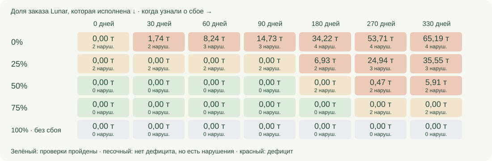
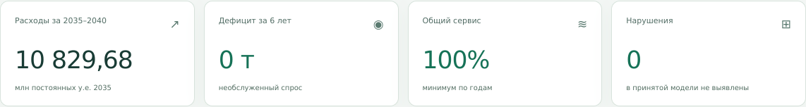
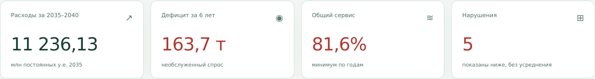
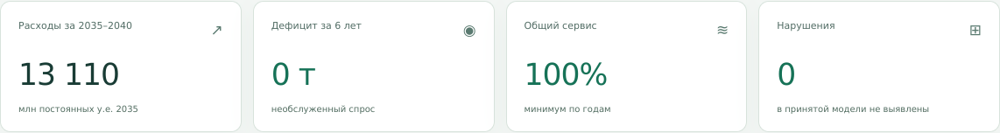
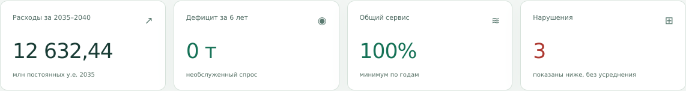
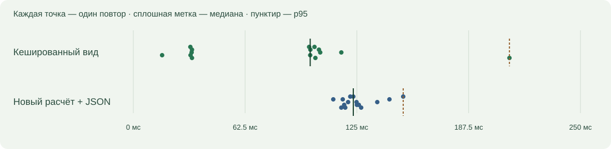

# Замеры и примеры работы сайта

Снимки — из работающего Chromium, не макеты. Для просмотра галереи запустите `/evidence` или откройте [автономный HTML](EVIDENCE.html).

## Карта границ реакции



[CSV](evidence/response-grid.csv) · [Полный JSON](evidence/response-grid.json). 35 точек, не вероятность и не непрерывная граница. Старые обязательства сохраняются. 100% исполнения — контроль без сбоя, не успешная мера.

## Реальный интерфейс

### 01 · Обычные условия



### 02 · Те же заказы в стрессе



### 03 · Подготовились заранее



### 04 · А если сбоя не будет?



## Тёплый локальный прогон



| Операция | Медиана, мс | p95, мс |
|---|---:|---:|
| Кешированный вид | 98,9 | 210,3 |
| Новый расчёт реакции + JSON | 123,0 | 150,9 |

Chromium 133.0.6943.0; Intel(R) Xeon(R) Processor @ 2.60GHz; linux / x64; viewport 1440×1080.

15 измерений после 3 прогревов, по одной операции. UI: программный DOM-клик → 2 кадра. API: HTTP POST → JSON decode. Не Интернет-задержка пользователя, не холодный запуск, не конкурентная нагрузка, не SLA. Перцентили — nearest rank; при n=15 p95 = максимум. Небольшая выборка, общего ускорения относительно прошлой версии не заявляем.

[Сырые измерения, окружение, хеши кода и скриншотов](evidence/browser-measurements.json). SHA256 файлов точнее идентифицируют проверенный код, чем source_revision, который мог предшествовать незакоммиченным изменениям. Повторный замер даст другие времена — их не подгонять под этот снимок.

## Как воспроизвести

```bash
.venv/bin/python -m fuel.cli suite --output results
.venv/bin/python tools/evidence.py
# Сервер должен быть запущен; Playwright/Chromium — RUNBOOK
NODE_PATH=/tmp/fuel-browser/node_modules node tools/demo-evidence.cjs
.venv/bin/python tools/evidence_publish.py
.venv/bin/python tools/defense.py --pptx
```

Для проверки баланса вручную: [один день с настоящими числами](evidence/BALANCE.md). Не путать тёплый кеш витрины с новым запуском экономической модели.
