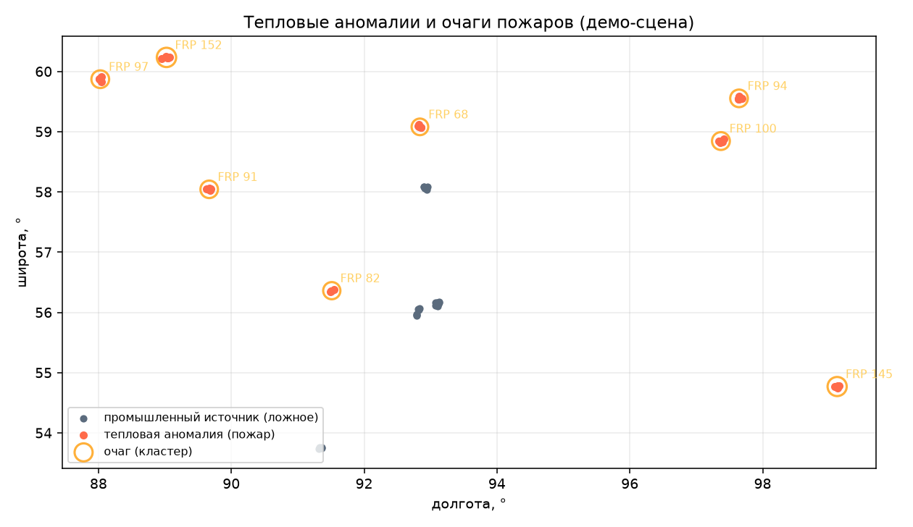
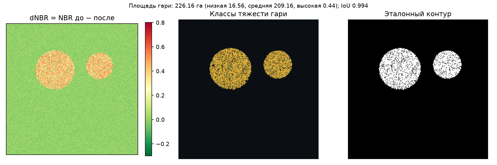

# КосмоФАЙР — оперативный мониторинг лесных пожаров

Решение кейса **«Оперативный мониторинг лесных пожаров»** (КосмоХакатон, Красноярск,
18–20.09.2026). Готово к запуску оффлайн: данные генерируются синтетически, но провайдеры
реальных срезов описаны и подключаются одной строкой.



## Что решает

Оперативный контур «спутниковые данные → очаг пожара → площадь гари → решение диспетчера»:

1. **Детекция тепловых аномалий** — MODIS/VIIRS (Terra, Aqua, NOAA-20/21, SUOMI NPP), яркость,
   FRP, уверенность, день/ночь.
2. **Отсев ложных срабатываний** — промышленные факелы, ТЭЦ, НПЗ, блики. Интерпретируемая
   логистическая модель на физических признаках (яркость, FRP, плотность и однородность
   окрестности, близость к известным промзонам).
3. **Кластеризация в очаги** — собственная DBSCAN-подобная реализация (радиус в км, min_samples),
   агрегаты: число детекций, суммарный FRP, число спутников, окно времени, уверенность.
4. **Приоритет очага** — FRP × уверенность, сортировка для диспетчера.
5. **Картирование гари** — Sentinel-2, dNBR (NBR до/после), классы тяжести по порогам USGS,
   морфологическая чистка, площадь в гектарах.
6. **Метрики** — precision/recall/F1 по точкам и по очагам, ошибка локализации в км,
   IoU/Dice по контуру гари, относительная ошибка площади.

## Архитектура

```
                ┌──────────────┐   ┌───────────────┐   ┌──────────────────┐
 NASA FIRMS ──▶ │  providers   │──▶│  filter.py    │──▶│  cluster.py      │
 (MODIS/VIIRS)  │ (загрузка,   │   │ отсев ложных  │   │ очаги + приоритет│
 Sentinel-2 ──▶ │  кэш, оффлайн)│   │ (логит-модель)│   │ (DBSCAN-подобный)│
                └──────────────┘   └───────────────┘   └────────┬─────────┘
                                                               │
   burnscar.py (dNBR, тяжесть, га)  ──▶  service.py (FastAPI + веб-карта)  ──▶  диспетчер
   metrics.py   (F1/IoU/ошибка га)  ──▶  cli.py (отчёт JSON + фигуры)       ──▶  презентация/отчёт
```

Модули и роли:

| Файл | Назначение |
|---|---|
| `cosmofire/synthetic.py` | генерация демо-сцены (детекции, эталон, пара снимков NBR) |
| `cosmofire/providers.py` | подключение реальных данных: FIRMS CSV API, Sentinel-2 через STAC |
| `cosmofire/filter.py` | признаки + логистическая модель правдоподобия + объяснение решения |
| `cosmofire/cluster.py` | кластеризация очагов, агрегаты, уверенность |
| `cosmofire/burnscar.py` | dNBR, классы тяжести, площадь в га, IoU/Dice |
| `cosmofire/metrics.py` | метрики точек, очагов, площади |
| `cosmofire/service.py` | REST API + веб-карта (без CDN, работает оффлайн) |
| `cosmofire/cli.py` | `demo` (полный прогон + артефакты) и `explain` (разбор решений) |
| `cosmofire/plots.py` | фигуры для README и презентации |

## Запуск

```bash
python3 -m venv .venv && . .venv/bin/activate
pip install -r requirements.txt

python -m pytest tests -q                      # 5 тестов, ~1 c
python -m cosmofire.cli demo --out data        # отчёт, CSV, фигуры, severity-растр
uvicorn cosmofire.service:app --host 0.0.0.0 --port 8000
```

Сервис:

| Метод | Путь | Смысл |
|---|---|---|
| GET | `/` | веб-карта: аномалии, очаги, карта гари, метрики |
| GET | `/api/detections?only_fire=true` | детекции с p(пожар) |
| GET | `/api/fires` | очаги с приоритетом |
| GET | `/api/geojson` | GeoJSON для QGIS/Mapbox |
| GET | `/api/burnscar` | классы тяжести и площади |
| GET | `/api/metrics` | качество на валидационной сцене |
| POST | `/api/analyze` | свой список точек → разбор и очаги |

## Результаты на демо-сцене (`SceneConfig`, seed 20260918)

| Блок | Метрика | Значение |
|---|---|---|
| Детекции | precision / recall / F1 | 0.978 / 0.900 / 0.938 |
| Очаги | precision / recall / F1 | 1.000 / 1.000 / 1.000 |
| Очаги | средняя ошибка локализации | 0.18 км |
| Гарь | площадь | 226.16 га против 227.52 га эталона (−0.6 %) |
| Гарь | IoU / Dice | 0.994 / 0.997 |

Честная оговорка: на синтетике разделимость классов выше реальной. IoU по гари завышен,
потому что эталонный контур гладкий; на реальных снимках Sentinel-2 ожидаемый диапазон —
0.80–0.93 (влияют облачность, тени рельефа, недогоревшие «острова», точность совмещения).
Фильтр теряет часть настоящих пожаров рядом с промзонами (пример виден на карте: очаг у
Саяногорска размером 5 детекций отброшен как промышленный) — это осознанный компромисс,
который тюнится порогом и штрафом `w_industry`.



## Подключение реальных данных

```python
from cosmofire.providers import firms_area_csv, burn_scar_from_stac

# 1) Тепловые аномалии: NASA FIRMS (нужен MAP_KEY, бесплатный)
dets = firms_area_csv(
    "https://firms.modaps.eosdis.nasa.gov/api/area/csv/<MAP_KEY>/VIIRS_SNPP_NRT/88,53,100,61/2",
    cache="data/firms_cache.csv",
)

# 2) Гарь: Sentinel-2 L2A через STAC Copernicus
scene = burn_scar_from_stac(bbox=(88.0, 53.5, 100.0, 60.5), date_range=("2026-08-01", "2026-09-15"))
```

Используемые открытые источники: NASA FIRMS (MODIS/VIIRS, ~3 ч задержки, 375 м у VIIRS),
Copernicus Sentinel-2 L2A (SWIR 20 м), справочник промзон — Росреестр/ОSM + ручная верификация
по истории детекций. Все источники бесплатные, лицензии: FIRMS — public domain (NASA),
Sentinel-2 — Copernicus Open Access.

## Что докрутить в окне хакатона

1. Подключить реальный срез FIRMS за 2–3 суток и показать работу фильтра на живых данных.
2. Дообучить фильтр (градиентный бустинг) на исторических детекциях с метками подтверждений
   Авиалесоохраны; сравнить с текущей интерпретируемой моделью.
3. Кэш и инкрементальный расчёт (только новые детекции) — задержка обновления < 1 мин.
4. Телеграм-бот/вебхук оповещения дежурного с приоритетом очагов.
5. Уточнить модель площади: маска облаков, поправка на склон, кросс-сцена для больших гарей.

## Disclosure (важно по положению хакатона)

* Использованные открытые библиотеки: numpy, pandas, FastAPI, uvicorn, pydantic, tifffile,
  matplotlib, pytest, httpx. Список фиксируется в `requirements.txt`.
* Каркас пайплайна (провайдеры, фильтр, кластеризация, метрики, сервис) подготовлен **до**
  старта хакатона как техническая заготовка. Вклад в окне хакатона фиксируется историей
  коммитов репозитория сдачи; в README сдачи указывается, что именно сделано в 18–20.09.
* Данные в демо — синтетические (генератор в `cosmofire/synthetic.py`), реальные источники —
  открытые, с указанием ссылок и лицензий (см. выше).

## Лицензия

Код решения — MIT (файл `LICENSE` в репозитории сдачи). Данные — по лицензиям источников
(NASA public domain, Copernicus Open Access).
