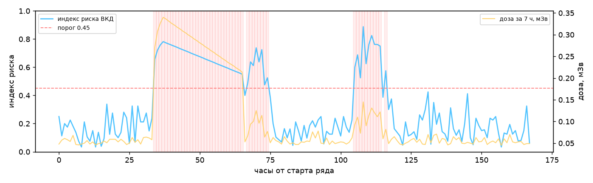

# КосмоРиск — оценка риска внекорабельной деятельности

Решение кейса **«Орбитальный риск»** (КосмоХакатон, Санкт-Петербург, 18–20.09.2026):
риск для космонавта при ВКД (выход в открытый космос) от солнечной и геомагнитной
активности, радиации и потока протонов. Система отвечает на три вопроса дежурного
экипажа: *можно ли выходить сейчас*, *какую дозу получит космонавт*, *когда ближайшее
безопасное окно*.

## Что решает

1. **Ряд космической погоды** — F10.7, Kp, Dst, потоки протонов ≥10 МэВ и электронов
   ≥2 МэВ, мягкий рентген + класс вспышки (A/B/C/M/X). Реальные данные — NOAA SWPC
   (GOES/DSCOVR), в демо — синтетика с реальными диапазонами.
2. **Композитный индекс риска ВКД** — нормированные вклады по NOAA-порогам:
   G1-буря (Kp ≥ 5), солнечное протонное событие (≥ 10 pfu), буря по Dst (≤ −50 нТл),
   вспышка класса M/X. Композиция — **правило доминирующей опасности** (worst-case), как в
   оперативных правилах: один «красный» фактор отменяет выход, спокойный Kp не маскирует SPE.
3. **Дозовая модель за защитой** — доза за типовую ВКД 7 ч в мЗв; лимит 1 мЗв на ВКД
   (упрощённо по NASA STD-3001), раздельно фон, вклад протонов и вклад захваченных частиц.
4. **Окна безопасности** — непрерывные интервалы, где ВКД разрешена не меньше N часов,
   с указанием максимального риска и дозы внутри окна.
5. **Оперативная рекомендация** — статус «сейчас», ведущие факторы и три ближайших окна.
6. **Метрики** — precision/recall/F1/CSI по опасным часам + заблаговременность
   предупреждения в часах + бюджет дозы.

## Архитектура

```
 NOAA SWPC ──▶ providers.py ──┐
 (Kp, Dst,                    │
  протоны,      synthetic.py ─┴──▶ risk.py ──▶ windows ──▶ service.py (API + дашборд)
  рентген)                        compute_risk   find_windows      │
                                     │                             ▼
                                  metrics.py (F1/CSI/lead-time/доза)   дежурный экипаж
```

| Файл | Назначение |
|---|---|
| `cosmorisk/synthetic.py` | синтетический ряд: бури, SPE, вспышки + эталонные опасные периоды |
| `cosmorisk/providers.py` | NOAA SWPC: Kp, Dst, протоны, рентген, F10.7 с дисковым кэшем |
| `cosmorisk/risk.py` | индекс риска, дозовая модель, окна, рекомендация, классы риска |
| `cosmorisk/metrics.py` | качество детекции событий, заблаговременность, бюджет дозы |
| `cosmorisk/service.py` | REST API + оффлайн-дашборд с графиком и окнами |
| `cosmorisk/cli.py` | `demo`: прогон ряда, отчёт JSON, окна, график PNG |

## Запуск

```bash
python3 -m venv .venv && . .venv/bin/activate
pip install -r requirements.txt

python -m pytest tests -q                    # 8 тестов
python -m cosmorisk.cli demo --out data      # risk_series.csv, windows.json, report.json, risk_chart.png
uvicorn cosmorisk.service:app --host 0.0.0.0 --port 8001
```

API:

| Метод | Путь | Смысл |
|---|---|---|
| GET | `/` | дашборд: статус «сейчас», драйверы, график риска, окна, метрики |
| GET | `/api/weather` | ряд космической погоды |
| GET | `/api/risk` | индекс риска, класс, доза, разрешение на ВКД |
| GET | `/api/windows` | безопасные окна (≥ 3 ч) |
| GET | `/api/recommend` | оперативная рекомендация и 3 ближайших окна |
| GET | `/api/metrics` | precision/recall/F1/CSI, заблаговременность, бюджет дозы |
| POST | `/api/assess` | свой ряд в JSON → риск, окна, рекомендация |

Пример запроса:

```bash
curl -s localhost:8001/api/assess -H 'content-type: application/json' -d '{
 "series":[{"time":"2026-09-18T00:00:00Z","kp":7.0,"dst":-150,"proton_flux_10mev":250,"xray_flux":2e-4}]}'
```

## Результаты на демо-ряду (168 ч, seed 20260918)

| Метрика | Значение |
|---|---|
| precision / recall / F1 (опасные часы) | 1.000 / 0.944 / 0.971 |
| CSI | 0.944 |
| Заблаговременность предупреждения | 31 ч |
| Опасных часов | 51 из 168 |
| Доза за первые сутки (запас) | 1.29 мЗв при лимите 10 мЗв |
| Скорость расчёта | 168 точек < 0.1 с (полный API-ответ < 0.3 с) |

Оговорки: синтетический ряд даёт гладкие бури, поэтому метрики оптимистичнее реальных
(на живых данных Kp/Dst «дёргаются», часть событий приходит без предвестников). Дозовая
модель — инженерная оценка сверху, а не результат транспорта частиц: для защиты нужно
заменить её на расчёт по спектру (например, AP-8/AE-8 или SPENVIS) и указать модель
защиты скафандра.



## Физика и источники порогов

| Фактор | Порог | Почему важен для ВКД |
|---|---|---|
| Kp | ≥ 5 (G1) | рост потока захваченных протонов на НОО, ухудшение радиационной обстановки |
| Протоны > 10 МэВ | ≥ 10 pfu | солнечное протонное событие: основная радиационная опасность вне станции |
| Dst | ≤ −50 нТл | сильная буря: рост дозы при пролёте высокоширотных участков |
| Рентген | ≥ 1e-5 Вт/м² (класс M) | вспышка + маркер возможного SPE через десятки минут |
| Доза за ВКД | ≥ 1 мЗв | лимит на выход (упрощённо по NASA STD-3001) |

Открытые источники: NOAA SWPC (Kp, Dst, GOES-протоны и рентген, F10.7 — public domain),
NASA STD-3001 для лимитов дозы, шкалы NOAA G/S/R для порогов.

## Что докрутить в окне хакатона

1. Подключить живые данные SWPC (`cosmorisk.providers.live_weather`) и показать реальный
   текущий статус — это визуально сильный момент на защите.
2. Прогноз на 2–3 суток вместо nowcast (persistence + простая авторегрессия по Dst/Kp).
3. Модель прохождения орбиты: высокоширотные участки получают больше дозы — связать окна
   ВКД с расписанием витков (TLE от Celestrak) и временем выхода.
4. Дозовый бюджет экипажа на месяц/год и учёт истории облучения.
5. Интеграция с ЦУП: уведомление при переходе статуса в «запрещено», объяснение причин.

## Disclosure (важно по положению хакатона)

* Библиотеки: numpy, pandas, FastAPI, uvicorn, pydantic, matplotlib, pytest, httpx.
* Пороги и физика опираются на открытые публикации и шкалы NOAA/NASA (ссылки выше).
* Каркас пайплайна подготовлен до старта хакатона; в README сдачи указывается объём работы,
  выполненной в окне 18–20.09.2026 (история коммитов репозитория сдачи — доказательство).
* Демо-данные синтетические; реальные — открытые, с указанием источника и лицензии.

## Лицензия

Код решения — MIT. Данные NOAA SWPC — public domain.
